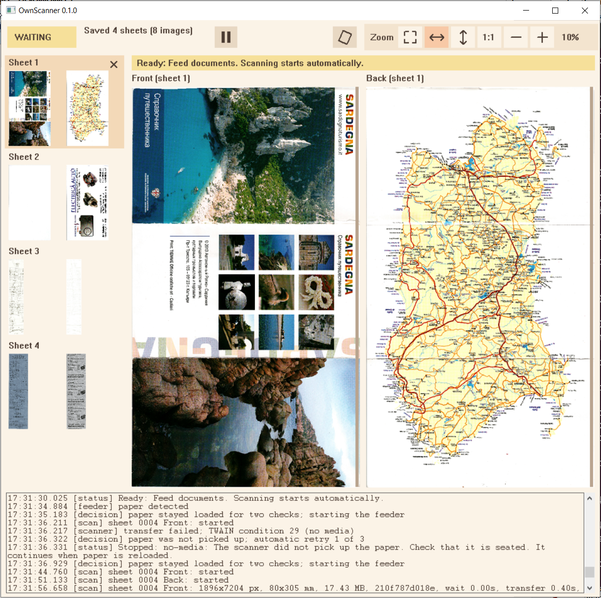

# OwnScanner

**Start it, feed documents, watch every page appear, fix paper problems, and keep going.**

OwnScanner is a small Windows batch scanner for invoices, receipts, and other paper. It captures both sides as lossless PNG files and leaves rotation, cleanup, classification, and OCR for later, so the originals stay as close to the scanner output as possible.



> **Status: early release.** OwnScanner has been tested with a Canon imageFORMULA DR-M260 on Windows 10 x64. Other TWAIN scanners should be detected, but have not been tested yet. See [Known limitations](#known-limitations) before scanning irreplaceable documents.

## Features

- **Continuous scanning:** scanning starts when paper is detected, and adding more paper continues the same batch.
- **Live review:** front and back appear side by side, with every sheet from the session in a scrollable list.
- **Lossless originals:** one PNG per side, with DPI metadata, atomic writes, and no overwriting.
- **Raw capture by default:** deskew, auto-rotation, and blank-page removal are turned off.
- **Clear status:** green means nothing is needed (`STARTING`, `SCANNING`, `SCANNED`), yellow means you can add paper (`WAITING`, `PAUSED`), and red means you must fix something (`JAM`, `NOT READY`, `ATTENTION`, `LOCK WAIT`, `FAILED`).
- **Recovery without restarting:** fix the paper and reload it. A batch keeps its sheet numbering after a stop. If you pull a sheet out before it is captured, OwnScanner returns to waiting.
- **Pause and resume:** press <kbd>Space</kbd> or the pause icon.
- **Safe close:** closing during a scan stops feeding, saves everything already scanned, and then closes by itself. A jam or other problem cancels the close and stays on screen.
- **Safe delete:** remove a sheet from the session and move both sides to `.deleted`.
- **Explainable log:** the exact build, detections, decisions, driver settings, and one readable line per scanned side with timings.
- **Auditable batches:** a JSON manifest records sizes, statuses, SHA-256 hashes, and active processing.
- **Scanner detection:** uses the configured scanner, the only scanner found, or the system default, and asks when it cannot choose.
- **Single-file source:** one Rust file using only the standard library.

## Requirements

- Windows x64
- A scanner with a **64-bit TWAIN driver**
- The 64-bit TWAIN Data Source Manager (`TWAINDSM.dll`), usually installed with the scanner driver
- [Rust](https://www.rust-lang.org/tools/install) to build from source

Check what OwnScanner can see:

```bash
ownscanner scanners
```

## Install

### With Scoopix

```bash
scoopix install "git+https://github.com/raisercostin/ownscanner#main:ownscanner.rs" --name ownscanner --approve-rustc-build
ownscanner --version
```

From a local checkout:

```bash
scoopix install d:/path/to/ownscanner/ownscanner.rs --name ownscanner --approve-rustc-build --force
```

### From source

```bash
rustc --edition 2024 ownscanner.rs -O -o ownscanner.exe
./ownscanner.exe --version
```

Always build with `-O`. Without it, PNG encoding is much slower.

## Quick start

```bash
ownscanner config init D:/Scans
ownscanner scan
```

Then load paper into the feeder. Scanning starts automatically.

You can also choose a folder for one run:

```bash
ownscanner scan D:/Scans/invoices
```

## Using the window

| Action | How |
|---|---|
| Scan | Load paper |
| Add more paper | Load it, and the same batch continues |
| Pause or resume | <kbd>Space</kbd> or the pause icon |
| Review a sheet | Click it in the left list |
| Return to the newest sheet | Click the selected sheet again |
| Fit the image | **Full page**, **Fit width**, or **Fit height** icons |
| Straighten the view | **Deskew view** icon. The original PNG is not changed |
| Straighten while scanning | `ownscanner scan --deskew`, or `deskew = true` in config. Saved images are rotated by the driver |
| Show real scan pixels at 100% | **1:1** |
| Inspect a spot | Double-click it for 100%, then double-click again to return to the fit view |
| Zoom up to 400% | **-**, **+**, or <kbd>Ctrl</kbd> + mouse wheel around the cursor. The current level is shown beside the icons |
| Move a zoomed image | Drag it, use the wheel, or <kbd>Shift</kbd> + wheel for sideways |
| Delete a sheet | Select it, then click its **×** |
| Recover from a paper stop | Fix the paper and reload it |
| Retry without reloading | **Retry feeding**, shown only after a paper stop |
| Finish | Close the window. If images are still arriving, feeding stops, the window shows that it is saving, and it closes by itself when everything is saved. A jam or other problem cancels the close and stays on screen |

Pause stops feeding as soon as the driver allows it, which is when the first image is ready, so one more sheet may still be pulled. Sheets already read by the driver are still saved. Read-ahead is on by default for speed. To stop closer to the current sheet, run `ownscanner scan --disable-read-ahead`, which scans more slowly.

## Output

```text
D:/Scans/
  scan_20261121161524305_0001_Fron_600_None.png
  scan_20261121161524305_0001_Back_600_None.png
  scan_20261121161524305.manifest.json
  scan_20261121161524305.log
  .deleted/
```

The file pattern is `prefix_batch_sheet_side_dpi_dropout.png`. Both sides of a sheet share the batch and sheet number.

The log explains what happened during the session. The manifest is the machine-readable batch record: scanner, settings, sheet pairing, image sizes, partial scans, stop reasons, and SHA-256 hashes for checking files later. Images remain usable without it.

## Configuration

Configuration is resolved in this order, and the first file found is used:

1. `--config <file>`
2. `./.ownscanner.toml`
3. `$XDG_CONFIG_HOME/ownscanner/config.toml`, or `~/.config/ownscanner/config.toml`
4. `C:\ProgramData\ownscanner\config.toml`
5. Built-in defaults

```toml
schema_version = 1

[scan]
output_dir = 'D:\Scans'
# scanner = 'Exact TWAIN source name'
prefix = "scan"
read_ahead = true # faster; Pause can still save sheets already read
deskew = false # true makes the driver rotate saved images
dpi = 600
color = "rgb24" # rgb24 or gray8
duplex = true
max_length_mm = 5588
margin_mm = 0.0 # reserved
```

Useful commands:

```bash
ownscanner config path
ownscanner config show
ownscanner config values
ownscanner config values dpi
ownscanner scanners
ownscanner probe
```

`probe` reads scanner capabilities without feeding paper.

## Known limitations

- Vendor-specific protections are not enabled yet. On the DR-M260, a crooked receipt can pass without a skew error and may be clipped.
- Long-document mode is requested through the DR-M260 device profile. Very long documents still need more real-world testing, and Canon warns that long modes delay jam detection.
- The driver may still apply its own internal image processing, even when optional processing is off.
- Jam, skew, cover, and double-feed reporting depends on what each driver exposes.
- OCR and document classification are not included yet.
- Windows only for now. A Linux port is being explored.

## Development

```bash
./ownscanner --dev-autoformat --dev-autoupdate --dev-test # format, rebuild if needed, and test
./ownscanner --dev-autoupdate scan                       # rebuild if needed and scan
```

Tests run through the application facade with a simulated scanner. Test artifacts stay in `target/tdd1`.

Model-specific behavior belongs in an optional `DeviceProfile`. Scanners without a profile use generic TWAIN.

Canon and imageFORMULA are trademarks of Canon Inc. OwnScanner is an independent project and is not affiliated with or endorsed by Canon.
